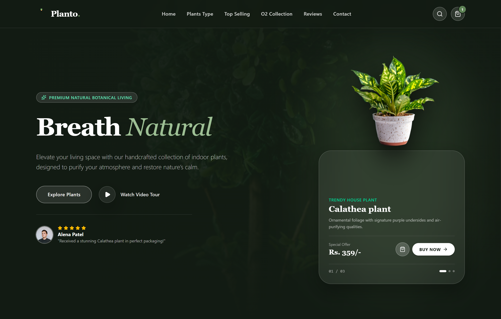
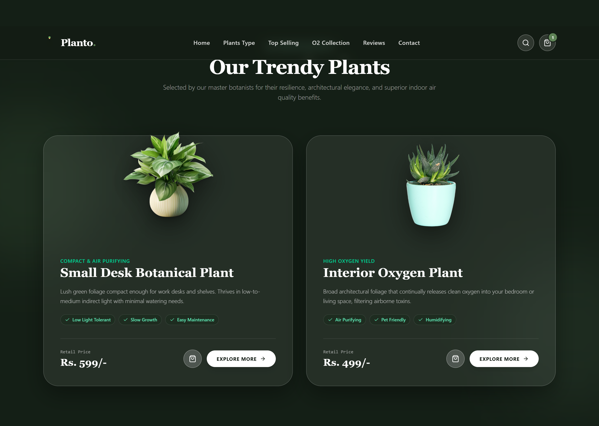
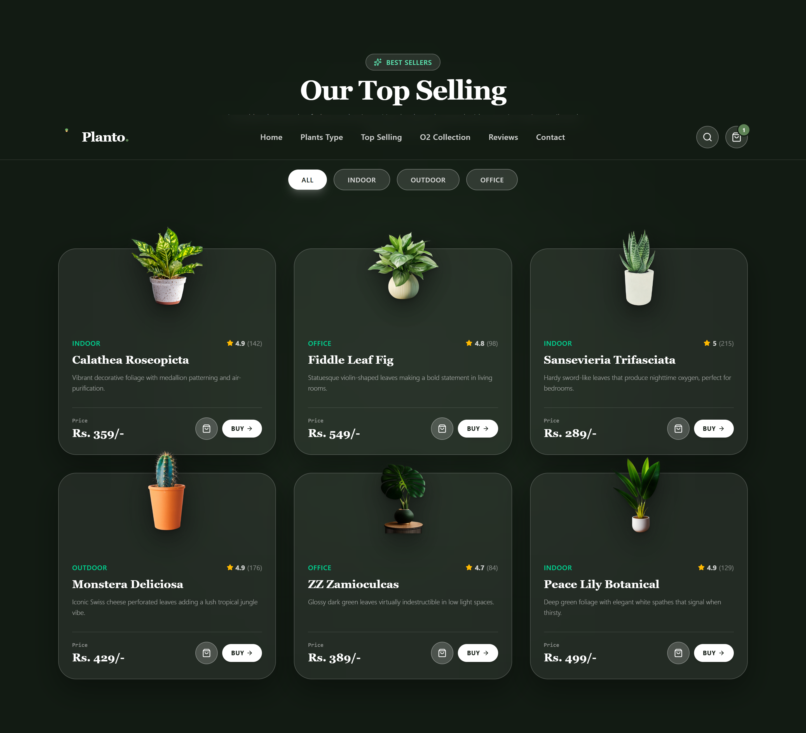
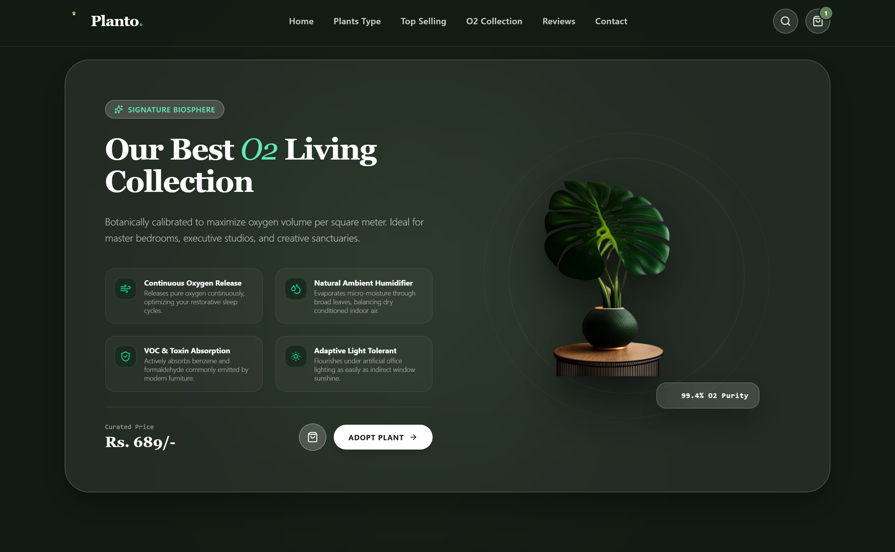
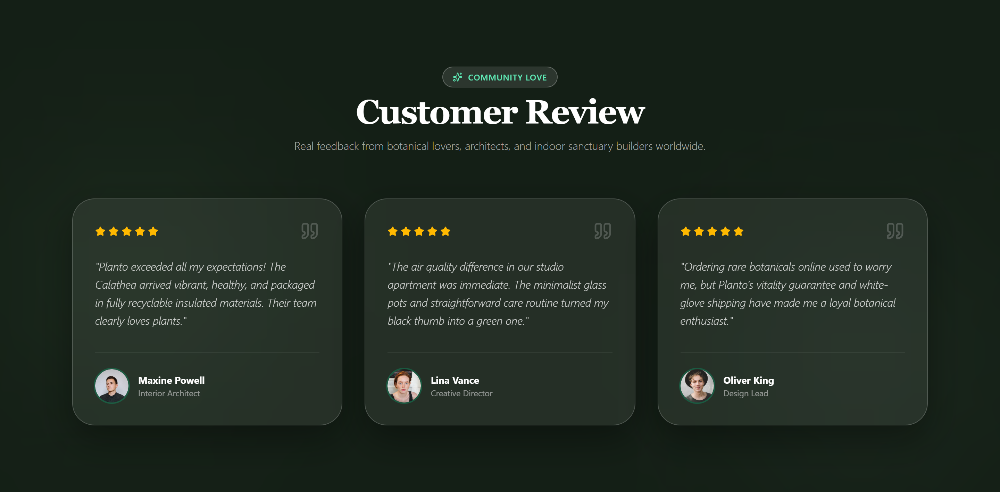
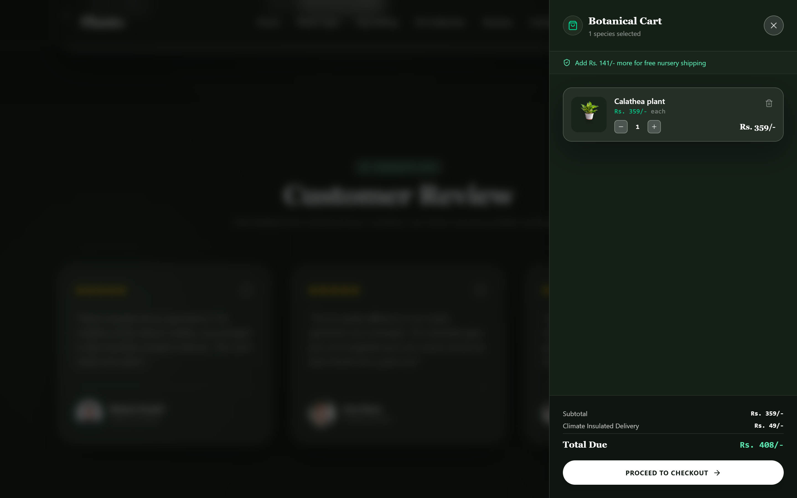
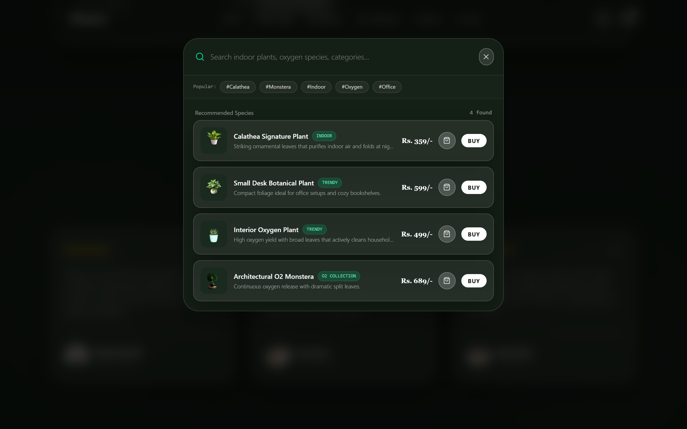

# Planto. — Interactive Botanical & House Plants E-Commerce Website

> A pixel-perfect, interactive 1:1 frontend realization of the **Planto.** luxury botanical landing page designed in Figma. Built with **React 19**, **Tailwind CSS v4**, and **Lucide Icons**.

[](https://react.dev/)
[](https://tailwindcss.com/)
[](https://vitejs.dev/)
[](LICENSE)

---

## 🌿 Overview

**Planto.** is a luxury e-commerce experience dedicated to modern indoor botany, air-purifying foliage, and natural interior living. The interface features a dark forest color palette, frosted glassmorphism elements, backdrop blurs, floating botanical cutouts with 3D overflow effects, and fully interactive components.

Original Figma Reference: [Interactive Website | Figma UI Design](https://www.figma.com/design/zho5DEAvB8rBjXpx8JTyeN/Interactive-Website--Figma-UI-Design-Tutorial-for-Beginners-%7C-Step-by-Step-Guide--Community-?node-id=0-1)

---

## 📸 Visual Showcase & Previews

| View / Section | Preview |
| :--- | :--- |
| **Hero & Atmosphere** |  |
| **Trendy Plants Showcase** |  |
| **Top Selling Grid** |  |
| **O2 Oxygen Collection** |  |
| **Customer Stories & Reviews** |  |
| **Slide-over Shopping Cart** |  |
| **Instant Real-Time Search** |  |
| **Mobile Responsive View** |  |

---

## ✨ Key Features

- **Pixel-Perfect Figma Fidelity**: Matches typography, exact colors (`#121B13`, `#182319`, `#5E8356`), frosted glass styling, and floating plant cutouts.
- **Interactive Shopping Bag Drawer**: Slide-over cart displaying quantities, subtotal calculations, dynamic free-shipping progress indicator, and item removal.
- **Instant Search Modal**: Real-time filtering across species names, plant categories, and characteristics with keyboard escape shortcut and quick filter tags.
- **Botanical Tour Video Modal**: High-definition video player preview showcasing plant nursery workflows and peat-free organic potting.
- **Quick Adoption / Purchase Modal**: Instant checkout with planter pot selection, live arrival guarantees, and instant confirmation state.
- **Category Filtering**: Seamless switching across All, Indoor, Outdoor, and Office plant types.
- **Responsive Layout**: Designed for seamless scaling across ultra-wide monitors, standard laptops, tablets, and mobile devices.

---

## 🛠️ Tech Stack

- **Framework**: [React 19](https://react.dev/)
- **Build Tool**: [Vite 8](https://vitejs.dev/)
- **Styling**: [Tailwind CSS v4](https://tailwindcss.com/) with custom `@utility` glassmorphism classes
- **Icons**: [Lucide React](https://lucide.dev/)
- **Typography**: Playfair Display (Serif) & Inter (Sans-Serif)

---

## 🚀 Getting Started

### Prerequisites

- Node.js `18.0.0` or higher
- npm or yarn

### Installation

```bash
# Clone the repository
git clone https://github.com/lxlnimalxl/planto-interactive-botanical-website.git

# Navigate into the project directory
cd planto-interactive-botanical-website

# Install dependencies
npm install

# Start local development server
npm run dev
```

The application will be accessible at `http://localhost:5173/` (or next available port).

### Production Build

```bash
# Compile and optimize for production
npm run build

# Preview production build locally
npm run preview
```

---

## 📄 License

This project is licensed under the [MIT License](LICENSE).
